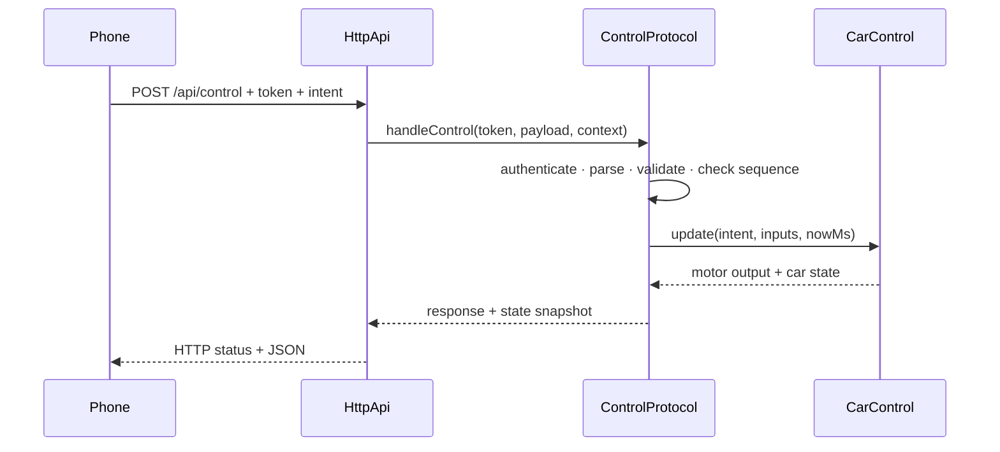

# System Architecture

## 1. Overview

This branch is a **phone-controlled car** with an obstacle interlock. The
ESP32 joins a Wi-Fi network and serves an HTTP control interface. A person
drives from a phone; the car refuses motion near an obstacle but never steers
itself away from one.

The architecture has one central seam: the **safety core**. Everything above
it is transport; everything below it is hardware. The safety rules live in the
core and nowhere else.

```text
┌──────────────────────────────┐
│ Phone browser                │
│ self-contained page (issue 7)│
└──────────────┬───────────────┘
               │ Wi-Fi / HTTP
               │ control intent + state snapshot
┌──────────────▼───────────────┐
│ HTTP adapter                 │
│ lib/HttpApi                  │
└──────────────┬───────────────┘
               │ ControlEndpoint
┌──────────────▼───────────────┐
│ Phone-facing protocol        │
│ lib/ControlProtocol          │
│ auth · JSON · sequencing     │
└──────────────┬───────────────┘
               │ ControlIntent + inputs + time
┌──────────────▼───────────────┐
│ Safety core                  │
│ lib/CarControl               │
│ rules · state · throttle ramp│
└──────────────┬───────────────┘
               │ MotorOutput + CarState
┌──────────────▼───────────────┐
│ Hardware adapters            │
│ motor · servo · sensor · ... │
└──────────────────────────────┘
```

The safety core performs no I/O and knows nothing about HTTP, JSON, Wi-Fi,
PWM or pins. That makes every implemented rule deterministic and host-testable.

---

## 2. Responsibilities

### Phone

* Presents the driving page and arming controls.
* Posts the requested throttle and steering angle at 20 Hz.
* Keeps the sequence counter increasing.
* Displays the returned state snapshot.

The phone is not trusted to enforce safety. It authenticates, but the car
still applies every rule locally.

### ESP32

* Serves the HTTP interface.
* Authenticates requests and rejects malformed, out-of-range, stale or replayed
  intents.
* Runs the safety core on every accepted intent.
* Drives the motor, servo, sensors, battery monitor and E-stop through adapters.
* Stops when the car link goes stale and whenever a safety rule requires it.

### Safety core

* Owns the armed state, requested throttle, actual throttle, steering angle
  and reported safety flags.
* Applies the precedence and steering rules in
  [`docs/safety-matrix.md`](safety-matrix.md).
* Slews the actual throttle toward the requested throttle; it never jumps.

### Hardware adapters

* Convert the core's `MotorOutput` into TC1508A inputs and PWM duty.
* Convert the steering angle into the SG90's servo angle.
* Read the frontal HC-SR04, battery divider and physical E-stop.
* Perform no policy decisions.

---

## 3. Module and dependency rules

```text
src/main.cpp
  ├── HttpApi ──────── ControlEndpoint
  └── ControlProtocol ─ ControlEndpoint
                         └── CarControl

CarControl ── CarTypes only
```

Rules:

* `CarControl` may not include Arduino, ArduinoJson, Wi-Fi, WebServer or any
  hardware wrapper.
* `ControlProtocol` may not implement HTTP status codes or socket details.
* `HttpApi` may not inspect or change the safety core's internals.
* `src/main.cpp` wires modules together and owns no safety rule.

This lets a future transport replace HTTP without changing a safety rule.

---

## 4. Request and state flow



A request rejected by authentication, parsing, validation or sequencing never
reaches the safety core. It changes neither the car nor the accepted sequence
counter.

---

## 5. Car state

The conceptual state is:

```text
CarState {
    armed              // accepts motion
    latched            // latched stop engaged
    latchReason        // why it is engaged
    estop              // physical E-stop pressed
    interlock          // obstacle near
    obstacleDistanceMm // nearest obstacle
    batteryState       // ok / low / critical
    requestedThrottle  // -100 .. +100
    motor {
        state          // coast / drive / brake
        actualThrottle // -100 .. +100, slewed
        steeringAngle  // -50 .. +50, relative to straight
    }
}
```

The state snapshot adds link and identity information: RSSI, IP address and
uptime.

---

## 6. Motion model

The car uses a bicycle model: one rear motor drives the rear wheels and one
front servo steers both front wheels. It cannot turn in place.

```text
R = L / tan(δ)
```

`L` and the maximum physical steering angle are not needed for the current
branch: there is no odometry, localization or path planning. The servo travel
limits are physical measurements recorded in
[`docs/hardware.md`](hardware.md).

---

## 7. Current implementation scope

Issue #6 implements:

* the HTTP control and state endpoints;
* token authentication and strict sequence handling;
* the transport-neutral `ControlEndpoint` interface;
* safety-core matrix rows S1 and S2;
* the requested-to-actual throttle ramp.

The motor adapter, phone page, complete control surface and on-car sensor
paths are later phases in [`docs/roadmap.md`](roadmap.md). The car must not be
driven on the floor until the obstacle interlock (#11) and physical E-stop
(#13) are implemented.
