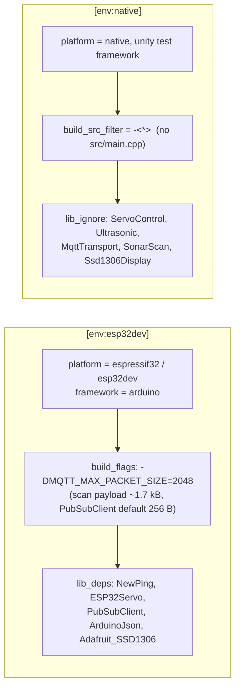

# Developer Guide — Build & Test

PlatformIO is at `~/.platformio/penv/bin/pio` (not on PATH by default).

---

## Commands

| Task | Command |
| ---- | ------- |
| Compile firmware | `~/.platformio/penv/bin/pio run` (builds `[env:esp32dev]` only) |
| Flash via USB | `~/.platformio/penv/bin/pio run -t upload` |
| Serial monitor | `~/.platformio/penv/bin/pio monitor` (115200) |
| Host unit tests | `~/.platformio/penv/bin/pio test -e native --without-uploading` |
| Flash wirelessly (OTA) | `~/.platformio/penv/bin/pio run -t upload --upload-port <car-ip>` |

### Wireless updates (OTA)

The firmware runs the ArduinoOTA client (`lib/OtaService`, UDP 3232), which the
PlatformIO `espota` uploader speaks. The espressif32 builder auto-switches to
`espota` whenever `--upload-port` is an IP, so the same env also still flashes
over USB (`-p /dev/ttyUSBx`).

```bash
# 1. ONCE: flash the OTA-enabled image over USB first
~/.platformio/penv/bin/pio run -t upload

# 2. Afterwards, wireless: pass the car's IP (serial "[net] Wi-Fi connected" line)
~/.platformio/penv/bin/pio run -t upload --upload-port 192.168.x.y
```

* Timeout/rollback is built in: a bad image rolls back to the previous slot
  automatically; USB re-flash always works as a final fallback.
* The image must stay under the app partition (currently **1.31 MB**; flashing
  a bigger one fails the build's size check).

---

## Environments



The native env must only build **pure** libraries — anything hitting Arduino/
ESP32 APIs is ignored, so the tests link and run on the host.

---

## What the tests cover

| Suite | File | Cases | Covers |
| ----- | ---- | ----- | ------ |
| `test_sonar` | `test/test_sonar/test_sonar.cpp` | 8 | `bearingFor()` (opposed sensors, wrapping), `ScanBuilder` (count, sort+stamp, reset), full-sweep 26-point invariant |
| `test_display` | `test/test_display/test_display.cpp` | 7 | `nearestObstacle()` (ignores no-echo, all-no-echo, empty), `StatusDisplay` page rendering + rotation (compact 2x16 and full 21x8 layouts, via `TextDisplay` stubs) |

Tests use Unity (`TEST_ASSERT_*`) and `int main()` with `RUN_TEST(...)`.

---

## Adding a testable piece

1. Keep the logic **hardware-free**: it must not `#include <Arduino.h>` or call
   ESP32 APIs. Type `uint32_t` etc. come from `<stdint.h>`.
2. Put it in `lib/` (e.g. `lib/Foo/Foo.h/cpp`).
3. Add `test/test_foo/test_foo.cpp` with the same `main()`/`RUN_TEST` shape.
4. Do **not** add the new lib to the native `lib_ignore` — `lib_ignore` is for
   hardware libs that would fail to link on the host.
5. Run `pio test -e native --without-uploading` — the task is not done until it
   passes.

To fake a hardware dependency in tests, implement the interface as a stub (the
pattern used by `FakeDisplay` for `TextDisplay` in `test/test_display`).

---

## Common failures

| Symptom | Cause / fix |
| ------- | ----------- |
| Tests "ERRORED" with a pass count before exit | A test assertion failed (run the native binary directly to see the FAIL line; `pio test` output can mask it). |
| `pio test` runs no tests | Empty `test/` requires an actual suite; use `-e native --without-uploading`. |
| Scans fail to publish on hardware despite building | `MQTT_MAX_PACKET_SIZE` too small for the payload (kept at 2048; scan is ~1.7 kB). |
| Firmware builds but `platformio.ini` errors | The INI is strict — a broken comment/section breaks every build. |