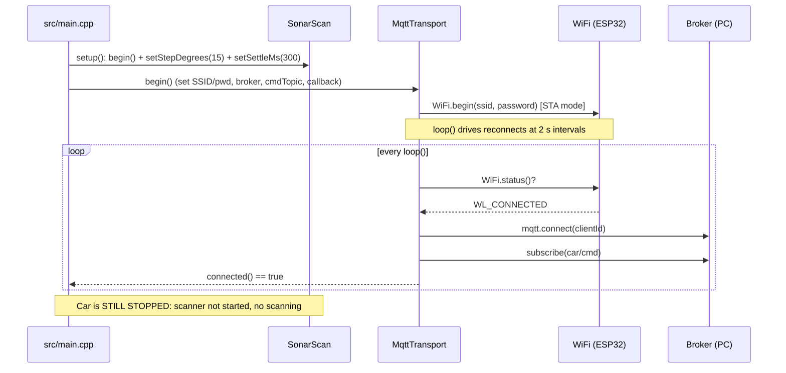
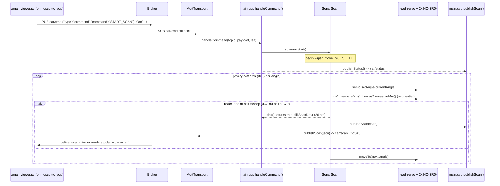
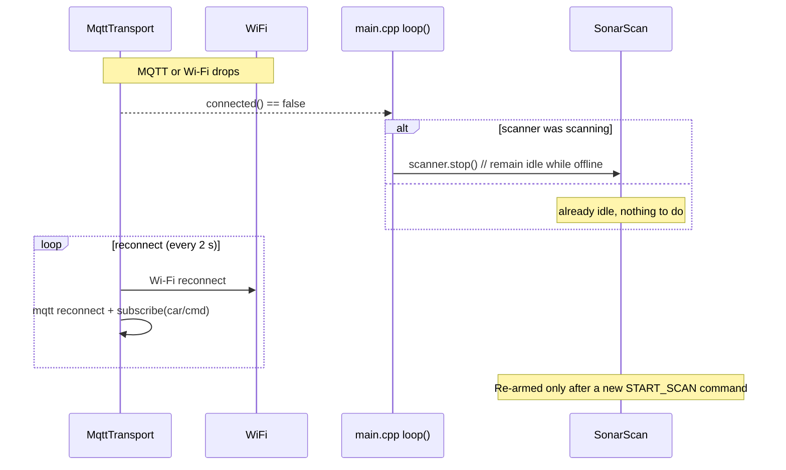
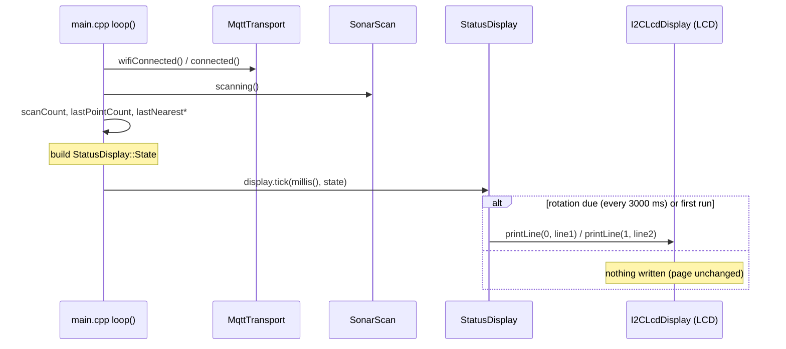

# Developer Guide — Data Flows

End-to-end flows through the system. All flows start from `loop()` in
`src/main.cpp`; MQTT endpoints are defined in `docs/communication.md`.

---

## 1. Boot and connect



Boot invariant: after setup, the car neither scans nor moves until a command
arrives on `car/cmd`.

---

## 2. START_SCAN command → servo sweep → scan publish

The two opposed HC-SR04s make every 0→180 half-sweep a complete 360° scan that
is published as one `car/scan` message.



Timing note: step 15° × settle 300 ms → one half-sweep ≈ 3.6 s → a scan
roughly every 3.6 s.

---

## 3. STOP_SCAN

```mermaid
sequenceDiagram
    participant V as sonar_viewer.py
    participant B as Broker
    participant M as MqttTransport
    participant C as main.cpp handleCommand()
    participant S as SonarScan

    V->>B: PUB car/cmd {"command":"STOP_SCAN"} (QoS 1)
    B->>M: callback
    M->>C: handleCommand(...)
    C->>S: scanner.stop()
    Note over S: stage = IDLE; servo stays where it was
    C-->>B: publishStatus() -> car/status (scanning: false)
```

---

## 4. Link loss (safety path)

The car must never scan or publish without a live link.



---

## 5. Display path (every loop pass)



Display is passive: it only reads state, never publishes or moves anything.

---

## 6. PC tool data roles

| Tool | Publishes | Subscribes | Drives the car? |
| ---- | --------- | ---------- | --------------- |
| `sonar_viewer.py` | `car/cmd` (S/X/P keys, `--auto-start`) | `car/scan` | Yes — commands only, car still enforces safety |
| `mock_scan_publisher.py` | `car/scan` (fake) | — | **No** — for GUI/schema tests only |

When testing with the real car, run the viewer (possibly `--auto-start`) and
stop the mock publisher so only real scans flow.