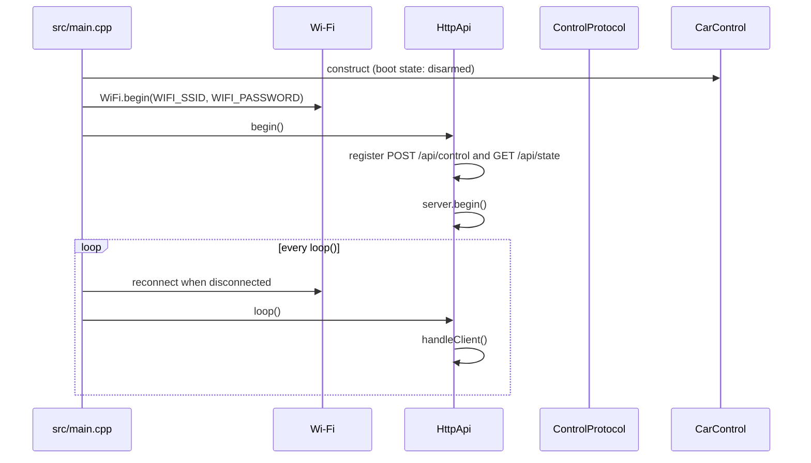
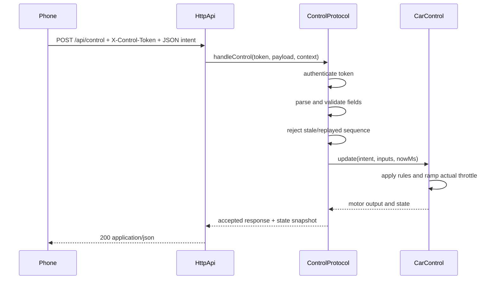
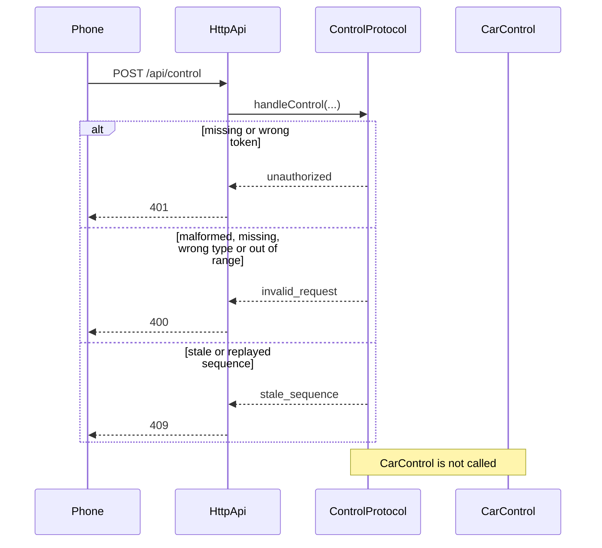
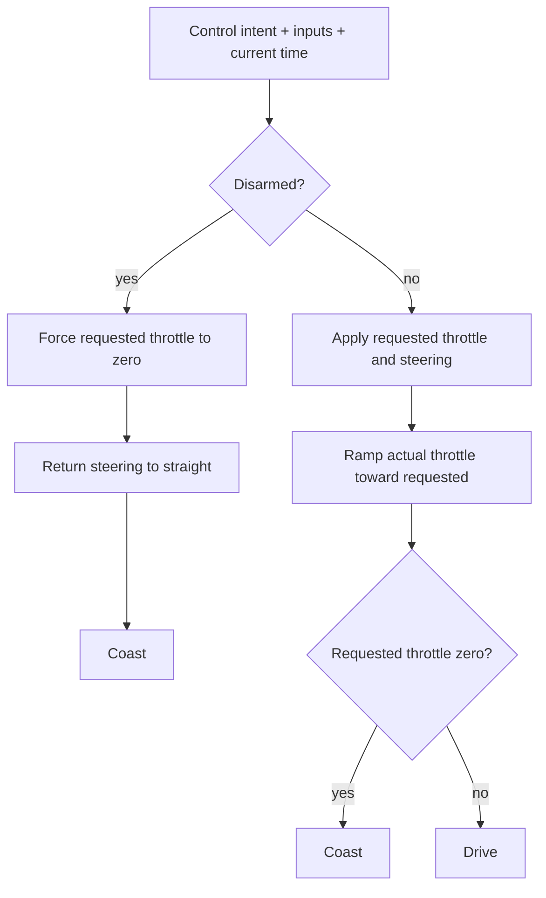
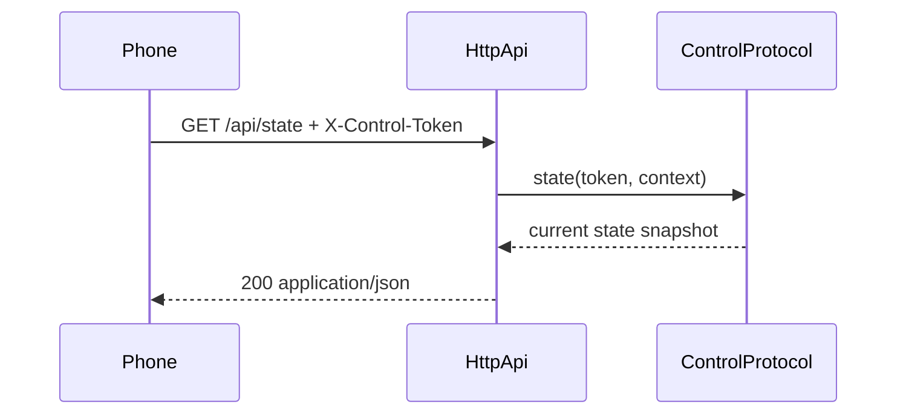

# Developer Guide — Data Flows

The current branch has one phone-facing flow: an HTTP control intent enters
the protocol module, the safety core decides what the car may do, and the
state snapshot returns over the same request.

---

## 1. Boot

The boot invariant is that the safety core is disarmed and its motor output
is coast. No request is needed to reach a stopped state, and no request can
make the car move before the motor adapter in issue #7 exists.

---

## 2. Accepted control intent

The HTTP adapter only moves bytes. Authentication, validation, sequence
handling and safety rules all live behind `ControlEndpoint`.

---

## 3. Rejected control intent

A rejected request changes neither the car's state nor its last accepted
sequence counter.

---

## 4. Safety-core update

This is the scope implemented by issue #6: matrix rows S1 and S2 plus the
throttle ramp. Later safety tickets add their rows inside the same module.

---

## 5. State request

The state request never calls the safety core and never changes the car.
