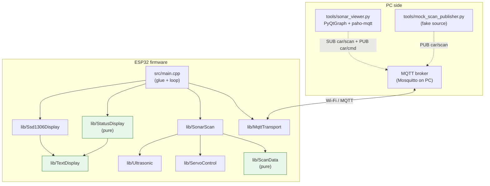

# Developer Guide — Index

Reference documentation for the **current implementation**. This is the map
that connects the project docs (`architecture.md`, `communication.md`,
`hardware.md`, `roadmap.md`, `decisions.md`) to the actual code.

| Document | What it answers |
| -------- | --------------- |
| [modules.md](modules.md) | What each component does, its public API, dependencies, and how they relate. |
| [data-flows.md](data-flows.md) | End-to-end message/control flows: boot, scanning, publishing, offline handling, display. |
| [state-and-lifecycle.md](state-and-lifecycle.md) | The state machines and lifecycle invariants (sweep state, connection state, safety rules). |
| [integrations.md](integrations.md) | Every external touch point: MQTT topics, GPIO pins, config header, build envs, PC tools. |
| [build-and-test.md](build-and-test.md) | PlatformIO environments, what the unit tests cover, commands. |

---

## Repository map

```text
platformio.ini          # build config: [env:esp32dev] firmware, [env:native] host tests
src/main.cpp            # wiring/glue: instantiates everything, dispatch loop
include/
  config.example.h      # committed template for credentials (gitignored config.h)
lib/
  ServoControl/         # SG90 wrapper (steering + head servos)
  Ultrasonic/           # HC-SR04 wrapper (mm/cm measurement in mm)
  ScanData/             # pure scan data model + helpers (no hardware)
  SonarScan/            # head-sweep state machine (hardware tick)
  MqttTransport/        # Wi-Fi + MQTT connect/reconnect/publish wrapper
  TextDisplay/          # abstract character-grid display interface
  Ssd1306Display/       # 128x64 SSD1306 I2C OLED driver (TextDisplay impl)
  StatusDisplay/        # pure page renderer for the on-car display
tools/
  sonar_viewer.py       # PC GUI: subscribes car/scan, sends commands
  mock_scan_publisher.py# fake car/scan source for no-hardware testing
  requirements.txt      # PC tool dependencies
test/
  test_sonar/           # ScanData unit tests (8 cases, host)
  test_display/         # StatusDisplay + nearestObstacle tests (7 cases, host)
docs/                   # project + developer documentation
```

---

## Layer view



Green = pure, hardware-free logic (also compiled by the native host tests).

---

## "Where do I look for..."

| Task | Start here |
| ---- | ---------- |
| Change scan step/settle timing | `src/main.cpp` constants `kScanStepDegrees`, `kSettleMs` |
| Add a scan field to `car/scan` | `src/main.cpp` `publishScan()` + `docs/communication.md` §6 |
| Add a new command | `src/main.cpp` `handleCommand()`; extend `communication.md` command list |
| Trim/range a servo (e.g. steering travel) | `src/main.cpp` constants (e.g. `kSteerMinAngle`/`kSteerMaxAngle`) + `ServoControl` ctor defaults |
| Change the MQTT reconnect behavior | `lib/MqttTransport/MqttTransport.cpp` `loop()` / `connectBroker()` |
| Add a display page | `lib/StatusDisplay/StatusDisplay.cpp` `renderPage()` (dispatches to `renderCompact()`/`renderFull()`) + `pageCount()` |
| Support a different display | Implement `TextDisplay`, change the instantiation in `main.cpp` |
| Add a unit-testable helper | Put pure logic in `lib/` (no Arduino calls), add a `test/test_<x>/` suite |
| Change pin wiring | `src/main.cpp` pin constants + `docs/hardware.md` §3 (keep in sync) |
| Flash the car wirelessly | `pio run -t upload --upload-port <ip>` (see `build-and-test.md`) |
| Debug, flash, run tests | `docs/developer/build-and-test.md` |