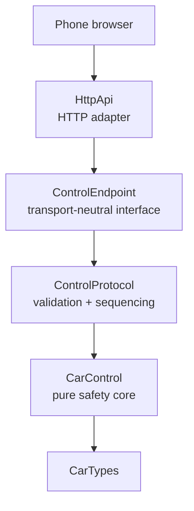

# Developer Guide — Index

Reference documentation for the current `feat/phone-controlled-car`
implementation.

| Document | What it answers |
| -------- | --------------- |
| [modules.md](modules.md) | What each module does and what its public interface is. |
| [data-flows.md](data-flows.md) | How a phone request reaches the safety core and returns. |
| [state-and-lifecycle.md](state-and-lifecycle.md) | The implemented safety-core and request-sequence lifecycles. |
| [integrations.md](integrations.md) | HTTP routes, GPIO assignments, configuration and external libraries. |
| [build-and-test.md](build-and-test.md) | Build, test and flash commands. |

The project-level references are [`docs/architecture.md`](../architecture.md),
[`docs/communication.md`](../communication.md),
[`docs/hardware.md`](../hardware.md), [`docs/roadmap.md`](../roadmap.md) and
[`docs/safety-matrix.md`](../safety-matrix.md).

---

## Repository map

```text
platformio.ini          # esp32dev firmware + native host-test environments
src/main.cpp            # wiring/glue
include/
  config.example.h      # committed template; include/config.h is gitignored
lib/
  CarControl/           # pure safety core
  ControlProtocol/      # JSON protocol, auth, sequence handling, serialization
  HttpApi/              # ESP32 HTTP adapter
  ServoControl/         # retained SG90 wrapper
  Ultrasonic/           # retained HC-SR04 wrapper
  OtaService/           # retained wireless-update wrapper
test/
  test_car_control/     # safety-core rules and throttle ramp
  test_control_protocol/# parser, auth, sequence handling and state snapshot
  test_config/          # committed configuration template
docs/
```

---

## Layer view



The safety core is the only module that decides what the car may do. It has no
knowledge of HTTP, JSON, Wi-Fi, PWM or pins.

---

## Where to look

| Task | Start here |
| ---- | ---------- |
| Change a safety rule | `lib/CarControl/CarControl.cpp` and `test/test_car_control/` |
| Change the request or response schema | `lib/ControlProtocol/` and [`docs/communication.md`](../communication.md) |
| Change HTTP routes or status codes | `lib/HttpApi/HttpApi.cpp` |
| Change the boot or Wi-Fi wiring | `src/main.cpp` |
| Add a hardware adapter | A new `lib/` module; keep hardware out of `CarControl` |
| Add a host test | `test/test_<module>/`; see [build-and-test.md](build-and-test.md) |
| Change pin wiring | `docs/hardware.md` §3 and the future adapter constant |
| Run tests or flash | [build-and-test.md](build-and-test.md) |
