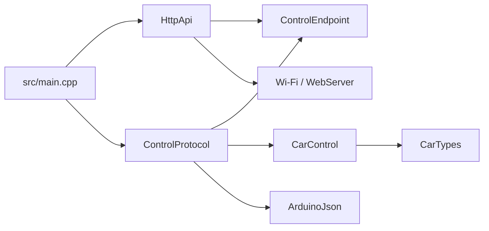

# Developer Guide — Modules

Every module's responsibility and public interface. `src/main.cpp` is glue;
the modules below own the logic.

---

## 1. Dependency graph



The safety core has no dependency on HTTP, ArduinoJson, Wi-Fi, PWM or pins.
The protocol depends on the safety core; the HTTP adapter depends only on the
transport-neutral `ControlEndpoint` interface.

---

## 2. `lib/CarControl` — safety core (pure, host-tested)

The safety core owns every implemented rule about what the car may do. It
takes a control intent, sensor inputs and the current time, and returns the
motor output and the car's state. It performs no I/O.

### Public interface

```cpp
class CarControl {
public:
    CarState update(const ControlIntent& intent,
                    const CarInputs& inputs,
                    uint32_t nowMs);
    const CarState& state() const;
};
```

`CarTypes.h` defines the domain vocabulary:

| Type | Important values |
| ---- | ---------------- |
| `ControlIntent` | requested throttle, steering angle, arm intent, latch intent, sequence |
| `CarInputs` | obstacle distance, E-stop, car-link freshness, battery state |
| `MotorOutput` | coast/drive/brake, actual throttle, steering angle |
| `CarState` | safety flags, requested throttle and the motor output |

### Implemented behaviour

Issue #6 implements matrix rows S1 and S2 and the throttle ramp:

* boot disarmed, stopped and coasting;
* a disarmed car refuses throttle and returns steering to straight;
* an arm request arms the car;
* an armed car applies requested throttle and steering;
* actual throttle reaches the requested throttle in 300 ms, in either
  direction, and reaches exactly zero before changing direction.

Rows S3–S8 are implemented by their later tickets. The input and state fields
already exist so those tickets extend the core rather than changing the
protocol.

---

## 3. `lib/ControlProtocol` — phone-facing protocol (host-tested)

`ControlProtocol` implements the `ControlEndpoint` interface. It owns JSON
parsing, token authentication, sequence rejection, the call into the safety
core, and state serialization. It performs no socket I/O.

### Public interface

```cpp
class ControlEndpoint {
public:
    virtual ControlResponse handleControl(const std::string& token,
                                          const std::string& payload,
                                          const EndpointContext& context) = 0;
    virtual ControlResponse state(const std::string& token,
                                  const EndpointContext& context) = 0;
};
```

`ControlProtocol` implements that interface and can therefore be reused by a
future UDP or native-phone adapter.

### Control-intent parser

`ControlIntentParser::parse()` accepts the complete JSON intent described in
[`docs/communication.md`](../communication.md). It rejects:

* malformed JSON;
* a missing field;
* a field with the wrong JSON type;
* requested throttle outside `-100` … `+100`;
* steering angle outside `-50` … `+50`.

The parser uses ArduinoJson internally; no other module includes ArduinoJson
directly.

### Authentication and sequence handling

* Every request must provide the configured shared token. An empty configured
  token means no request is valid.
* The last accepted sequence counter is remembered. A counter less than or
  equal to it is dropped as stale/replayed.
* Authentication, parsing and sequence checks happen before the safety core is
  called. A rejected request does not change the car or advance the sequence.

---

## 4. `lib/HttpApi` — HTTP adapter (ESP32-only)

`HttpApi` adapts HTTP requests to `ControlEndpoint`.

| Public API | Notes |
| ---------- | ----- |
| `HttpApi(ControlEndpoint&)` | stores the endpoint interface |
| `begin()` | registers the routes and starts the server |
| `loop()` | services pending HTTP requests |

Routes:

| Method | Path | Adapter behaviour |
| ------ | ---- | ----------------- |
| `POST` | `/api/control` | Reads the body and `X-Control-Token`, calls `handleControl()`, sends JSON. |
| `GET` | `/api/state` | Reads `X-Control-Token`, calls `state()`, sends JSON. |

The adapter maps protocol outcomes to HTTP status codes. It contains no safety
rules and is deliberately excluded from the native test environment.

---

## 5. Hardware modules retained on this branch

### `lib/ServoControl` — SG90 servo

Thin wrapper over `ESP32Servo`; 50 Hz PWM and degrees. The steering servo uses
GPIO 16 and the existing travel limits `[40°, 140°]`, with 90° = straight.

### `lib/Ultrasonic` — HC-SR04

Thin wrapper over `NewPing`; measurements are exposed in millimetres. The
branch uses one fixed frontal sensor. The 5 V echo is level-shifted as
specified in [`docs/hardware.md`](../hardware.md).

### `lib/OtaService` — wireless updates

Retained from the main line. The firmware currently keeps the module available;
the issue #17 ticket verifies that it still works beside the HTTP server.
