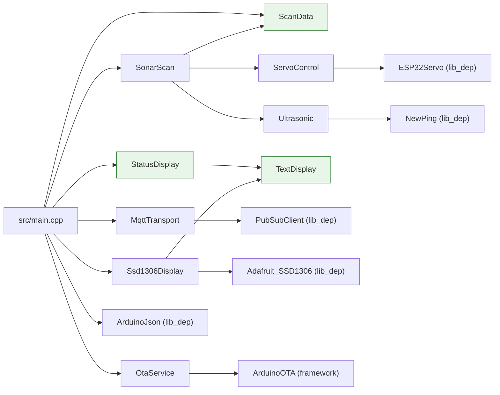

# Developer Guide — Modules

Every component: responsibility, public API, depends-on, and whether it is
hardware-free (host-testable). `src/main.cpp` is excluded here because it is
glue — see [data-flows.md](data-flows.md) for what it orchestrates.

---

## Dependency graph

`include` arrows point from consumer to dependency.

---

## Hardware wrappers (concrete, ESP32-only)

### `lib/ServoControl` — SG90 servo

Thin wrapper over `ESP32Servo`. 50 Hz PWM, angle in degrees. Each instance
carries its own angular travel; `setAngle()` clamps to it.

| Public API | Notes |
| ---------- | ----- |
| `ServoControl(uint8_t pin, int minAngle = 0, int maxAngle = 180)` | constructor; range defaults to `[0, 180]` |
| `begin()` | attaches the servo, parks at 90 |
| `setAngle(int angleDegrees)` | clamped to the configured `[min, max]` |
| `angle()` | last commanded angle |
| `minAngle()` / `maxAngle()` | configured travel |

Two instances live in the firmware (see `src/main.cpp`):

| Instance | Pin | Range | Default | Used for |
| -------- | --- | ----- | ------- | -------- |
| `steerServo` | 16 | `[40, 140]` | 90 (straight) | steering (STEER command) |
| (inside `SonarScan`) `head_` | 17 | `[0, 180]` | 90 | rotating sensor head |

The steering travel `[40, 140]` is a physical limit of the steering linkage
(`docs/decisions.md` #32).

### `lib/Ultrasonic` — HC-SR04

Thin wrapper over `NewPing`. Range cap: `kMaxDistanceCm = 400` (4 m).

| Public API | Notes |
| ---------- | ----- |
| `Ultrasonic(uint8_t trigPin, uint8_t echoPin)` | |
| `begin()` | sets pin modes, TRIG low |
| `measureCm()` | cm, via `ping_cm()` |
| `measureMm()` | mm, via `ping_cm() * 10` (**unit convention: mm**) |

> Note: `NewPing` has no mm API; `measureMm()` derives mm from cm.

---

## Scan pipeline

### `lib/ScanData` — pure data model (host-tested)

**Purpose:** everything about a scan that has no hardware. Two headers + one
impl; both are built by the `native` test env.

`ScanTypes.h` — data + free functions:

| Type / function | Notes |
| --------------- | ----- |
| `struct ScanPoint` | `bearing` (deg, [0,360)), `distanceMm` (0 = no echo), `sensor` (1 or 2) |
| `struct ScanData` | `timestampMs` + `std::vector<ScanPoint> points` |
| `int bearingFor(int headAngle, uint8_t sensor)` | sensor 1 = head angle; sensor 2 = head angle + 180 (mod 360) |
| `void sortByBearing(ScanData&)` | stable sort, ascending |
| `uint16_t nearestObstacle(const ScanData&, int* bearingOut)` | closest valid echo (distance > 0); 0 and `*bearingOut` unspecified if none |

`ScanBuilder.h` — accumulates points during a sweep:

| Public API | Notes |
| ---------- | ----- |
| `reset()` | start a new sweep |
| `add(int headAngle, uint8_t sensor, uint16_t distanceMm)` | record one reading |
| `pointCount()` | readings so far |
| `finish(uint32_t timestampMs)` | sort by bearing, stamp ts, **clear** builder, return dataset |

**Key invariant:** a full wiper half-sweep (0→180) at step `S` yields
`2 * (180/S + 1)` points covering the full 360° (two opposed sensors).

### `lib/SonarScan` — sweep state machine (hardware)

Drives the head servo + both sensors sequentially. Cooperative: `tick()` is
called from `loop()` and does one step per visit.

| Public API | Notes |
| ---------- | ----- |
| `SonarScan(headPin, trig1, echo1, trig2, echo2)` | pins baked at construction |
| `begin()` | init servo + sensors |
| `start()` / `stop()` | begin/end continuous scanning; **stopped at boot, never self-starts** |
| `scanning()` | active? |
| `setStepDegrees(int)` | clamped to `[1, 180]`, default 15 |
| `setSettleMs(uint32_t)` | settle time per angle, default 300 |
| `tick(uint32_t nowMs, ScanData& out)` | advance one step; returns `true` once per completed half-sweep, fills `out` |

Constants: `kMinAngle = 0`, `kMaxAngle = 180`.

State machine: see [state-and-lifecycle.md](state-and-lifecycle.md).

---

## Communication

### `lib/OtaService` — wireless updates (UDP 3232)

Thin wrapper over the ESP32 ArduinoOTA client from the framework library. It
lets PlatformIO flash the car over Wi-Fi; see [build-and-test.md](build-and-test.md)
for the exact command. Runs alongside MQTT (different port/protocol).

| Public API | Notes |
| ---------- | ----- |
| `OtaService(const char* hostname)` | sets the OTA/mDNS hostname (uses `MQTT_CLIENT_ID`) |
| `begin()` | register `onStart`, `ArduinoOTA.begin()`. **Idempotent and must only run after Wi-Fi/lwip is up** (ArduinoOTA binds UDP 3232, which panics if the network stack isn't initialized); `main.cpp` calls it on first Wi-Fi connect |
| `handle()` | service the update; call from `loop()` (no-op until `begin()`) |
| `setOnStart(std::function<void()>)` | called before the flash — `main.cpp` uses it to stop the scanner |

After the image is written the ESP32 reboots and reconnects MQTT. No password
provisioned yet (LAN-only).

### `lib/MqttTransport` — Wi-Fi + MQTT

Wraps `WiFiClient` + `PubSubClient`. Owns reconnect timing (2 s interval) and
the command callback hop. Publishes only while connected.

| Public API | Notes |
| ---------- | ----- |
| `MqttTransport(ssid, pwd, brokerHost, brokerPort, clientId, cmdTopic, scanTopic, statusTopic)` | all config injected at construction |
| `begin()` | set broker server + callback, start Wi-Fi in STA mode |
| `loop()` | call frequently: reconnect Wi-Fi/broker, service PubSubClient |
| `connected()` | Wi-Fi **and** MQTT up |
| `wifiConnected()` / `mqttConnected()` | individual link states (for the display) |
| `publishScan(const char* json)` | `car/scan`, QoS 0; `false` if not connected or publish fails |
| `publishStatus(const char* json)` | `car/status`, QoS 0 |
| `setCommandCallback(cb)` | `cb(topic, payload, length)` — invoked on any `car/cmd` message |

See [state-and-lifecycle.md](state-and-lifecycle.md) for the connection state
machine, [integrations.md](integrations.md) for topics.

---

## Display

### `lib/TextDisplay` — abstract interface (pure)

The migration seam. Any character-grid display (16x2 LCD, 20x4 LCD, OLED)
implements this; rendering logic never sees the physical device.

| Public API | Notes |
| ---------- | ----- |
| `rows()` / `cols()` | grid dimensions |
| `setCursor(row, col)` | move cursor (0-indexed) |
| `print(const char*)` | raw text at cursor |
| `printLine(row, text)` | clear line, print `text`, truncate > cols |

### `lib/Ssd1306Display` — 128x64 I2C OLED driver

`TextDisplay` implementation wrapping `Adafruit_SSD1306` + `Adafruit_GFX`,
default address `0x3C`. Buffered panel: `printLine()` flushes the framebuffer
and skips the I2C write when the row is unchanged.

| Public API | Notes |
| ---------- | ----- |
| `Ssd1306Display(uint8_t address, int width, int height, int sda=21, int scl=22)` | 128 × 64 for this car |
| `begin()` | `Wire.begin(sda, scl)` + init + clear |

Wiring: SDA = GPIO21, SCL = GPIO22, VCC = 3.3 V, GND. Long runs may need
~4.7 kΩ pull-ups (see `docs/hardware.md` §4).

### `lib/StatusDisplay` — pure page renderer (host-tested)

Takes any `TextDisplay` + a `State` struct and renders 3 auto-rotating pages.
Pages adapt to the display size: a compact two-line layout on a 2-row display,
or a fuller multi-line layout on a taller panel (e.g. the 128x64 OLED).
Status-only: reads state, never issues commands.

| Public API | Notes |
| ---------- | ----- |
| `StatusDisplay(TextDisplay&)` | |
| `begin()` | render page 0 |
| `tick(uint32_t nowMs, const State& s)` | rotate every `kRotateIntervalMs` (3000) |
| `pageCount()` | 3 |
| `setPage(int)` / `currentPage()` | manual override |

`State` fields: `wifiConnected`, `mqttConnected`, `scanning`, `scanCount`,
`pointCount`, `hasNearest`, `nearestMm`, `nearestBearing`.

Pages (16 chars):

| Page | Row 1 | Row 2 |
| ---- | ----- | ----- |
| Status | `IDLE` / `SCAN ON` | `WIFI:ok MQTT:ok` |
| Scan | `scan #<n>` | `pts: <n>` |
| Nearest | `near <n>mm` | `@ <ddd>deg` or `no echo` |

---

## PC tools (`tools/`)

### `sonar_viewer.py`

PyQtGraph + paho-mqtt. Subscribes `car/scan`, renders polar + Cartesian
scatter, and can send commands to `car/cmd`.

* Keys: `S` = START_SCAN, `X` = STOP_SCAN, `P` = PING (focused window).
* Flags: `--broker`, `--port`, `--topic`, `--cmd-topic`, `--auto-start`,
  `--max-distance`.
* Threading: MQTT messages arrive on the paho network thread; `_ScanBridge`
  (a `QObject` signal) forwards them to the Qt main thread — widgets are never
  touched off the GUI thread.
* paho-mqtt ≥ 2.0 handled via `CallbackAPIVersion.VERSION2` with a v1 fallback.

### `mock_scan_publisher.py`

Publishes synthetic `car/scan` JSON (same schema as the firmware) every
`--interval` seconds. Simulates a 3000 × 3000 mm room; ~5% dropouts. For
no-hardware GUI/schema testing only — **it never talks to the car**.

See [data-flows.md](data-flows.md) for the viewer/publisher role in tests.