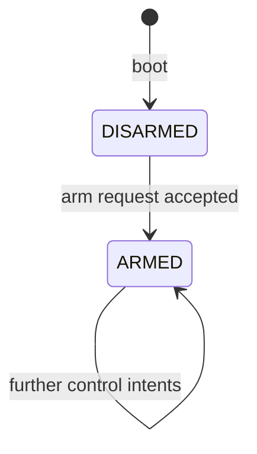
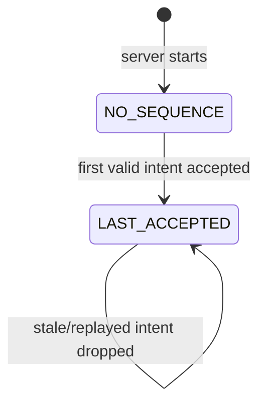

# Developer Guide — State & Lifecycle

The current branch has one implemented lifecycle: the safety core's disarmed
and armed states, plus the protocol's sequence counter.

---

## 1. Safety-core lifecycle

The arming-expiry transition is implemented by issue #9. The E-stop, stale-link
and latched-stop transitions are implemented by their own tickets.

### Disarmed

The car:

* reports `armed: false`;
* forces the requested throttle to zero;
* keeps the motor coasting;
* returns the steering angle to straight;
* ramps the actual throttle to zero rather than jumping.

### Armed

The car:

* applies the requested throttle and steering angle;
* reports both the requested and actual throttle;
* ramps the actual throttle toward the requested throttle at a bounded rate;
* keeps the motor coasting when the requested throttle is zero.

---

## 2. Throttle ramp

The actual throttle covers the full `-100` … `+100` range in 300 ms. The core
uses injected time, so host tests never wait.

When the requested throttle changes sign, the actual throttle reaches exactly
zero before it becomes negative (or positive). This gives the later motor
adapter a safe point at which to coast before changing direction.

---

## 3. Request-sequence lifecycle

Only a valid, authenticated intent advances the sequence counter. Invalid and
stale requests leave both the car and the counter unchanged.

---

## 4. Lifecycle invariants

| Invariant | Enforced at |
| --------- | ----------- |
| The car boots stopped and disarmed | `CarControl`'s initial state; no hardware output exists before the motor adapter ticket |
| A disarmed car refuses throttle | `CarControl::update()` |
| The actual throttle never jumps | `CarControl::update()` |
| A rejected request changes no state | `ControlProtocol::handleControl()` before `CarControl::update()` |
| The phone cannot bypass token authentication | `ControlProtocol` and the HTTP adapter |
| The safety core performs no I/O | `lib/CarControl` includes no Arduino or transport headers |
