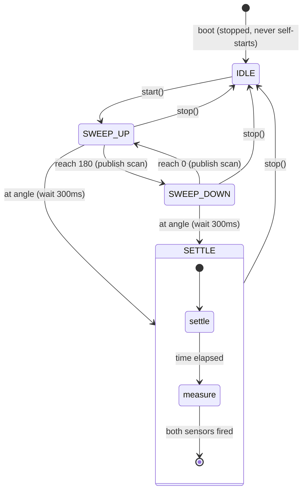
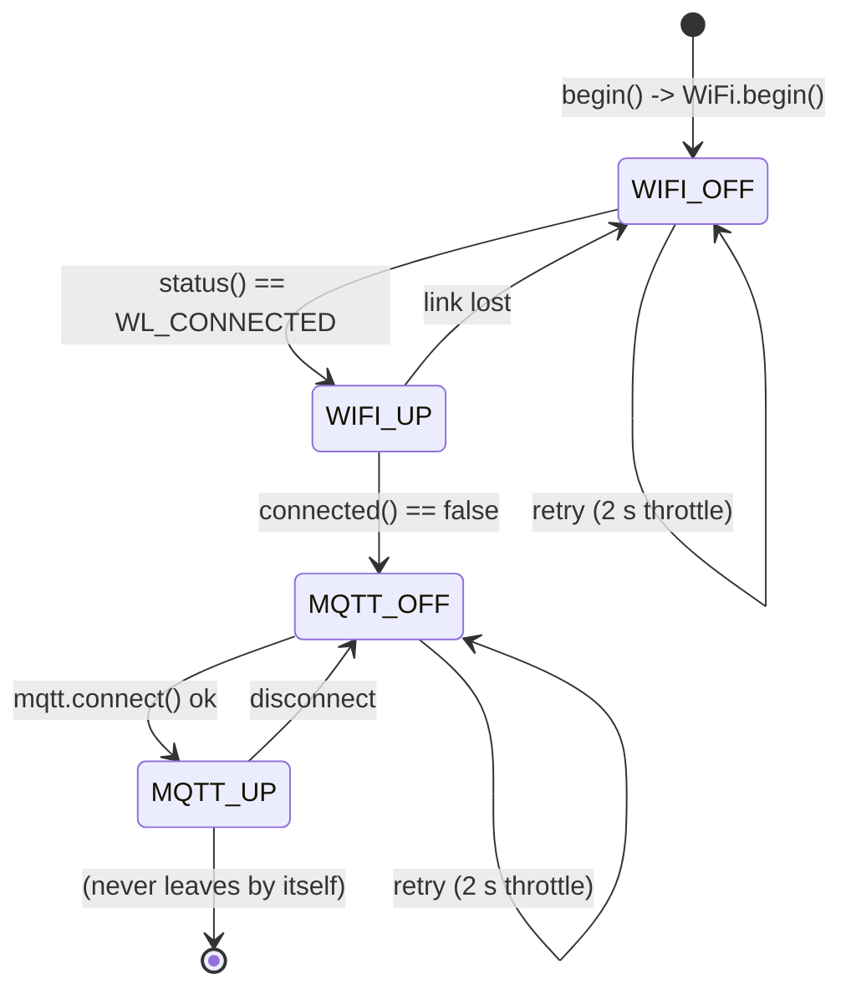

# Developer Guide — State & Lifecycle

The two state machines and the invariants that govern the whole firmware.

---

## 1. Scan lifecycle (`lib/SonarScan`)

Four implicit states: idle, swept toward 180, swept toward 0, plus settle
timing at every angle. Implemented as `scanning_`, `forward_`, `currentAngle_`,
`stage_` (`IDLE`/`SETTLE`).

Details:

* **tick()** returns `true` exactly once per completed 0→180 (or 180→0) sweep,
  filling `ScanData` — that is one full 360° scan (bearing set built from both
  sensors, sorted by bearing in `ScanBuilder::finish`).
* The turnaround angle belongs to both half-sweeps (i.e. both 0 and 180 appear
  in back-to-back scans; `ScanBuilder` is reset each time).
* Sensors fire **sequentially** (sensor 1 then sensor 2) at every angle to avoid
  crosstalk, after the settle delay lets the servo stop vibrating.
* `start()` while already scanning is a no-op; the servo does not move on
  `stop()` (holds current angle).

---

## 2. Connection lifecycle (`lib/MqttTransport`)

Wi-Fi and MQTT are tracked separately (the display shows each). Reconnect
attempts are throttled to every 2 s.

* `connected()` = WIFI_UP **and** MQTT_UP. Publish helpers refuse to send
  otherwise.
* On the broker side: while offline the car neither scans nor publishes
  (enforced in `loop()`, see data-flows §4).

---

## 3. Lifecycle invariants (never break)

From `AGENTS.md` §7, mapped to where they hold in code:

| # | Invariant | Enforced at |
| - | --------- | ----------- |
| 1 | Stop on command timeout (~500 ms) | Phase 2 feature — not yet implemented; `loop()` only scans while connected |
| 2 | Default on boot: **stopped** | `SonarScan::scanning_ = false` at construction; nothing calls `start()` in `setup()` |
| 3 | Wi-Fi/MQTT reconnect while stopped; never drive without live link | `loop()` gates `scanner.tick()` behind `mqtt.connected()` and calls `scanner.stop()` on link loss |
| 4 | Never bypass the E-stop path (software or physical) | Physical E-stop wiring is Phase 1; software `ESTOP` exists in the protocol but the handler is Phase 2 |

These are the unshakeable rails — any refactor must keep them.

---

## 4. Display lifecycle (`lib/StatusDisplay`)

Simple timer-driven rotation, no state machine of its own:

* `begin()` renders page 0 immediately.
* `tick(nowMs, state)` renders the *current* page on first call, then advances
  `currentPage = (currentPage + 1) % 3` every `kRotateIntervalMs` (3000 ms).
* Rendering is idempotent: `printLine()` rewrites the row in place, so no
  diffing bothers — the panel just gets overwritten on every page change. Pages
  adapt to the display size (compact 2-line vs. fuller multi-line).